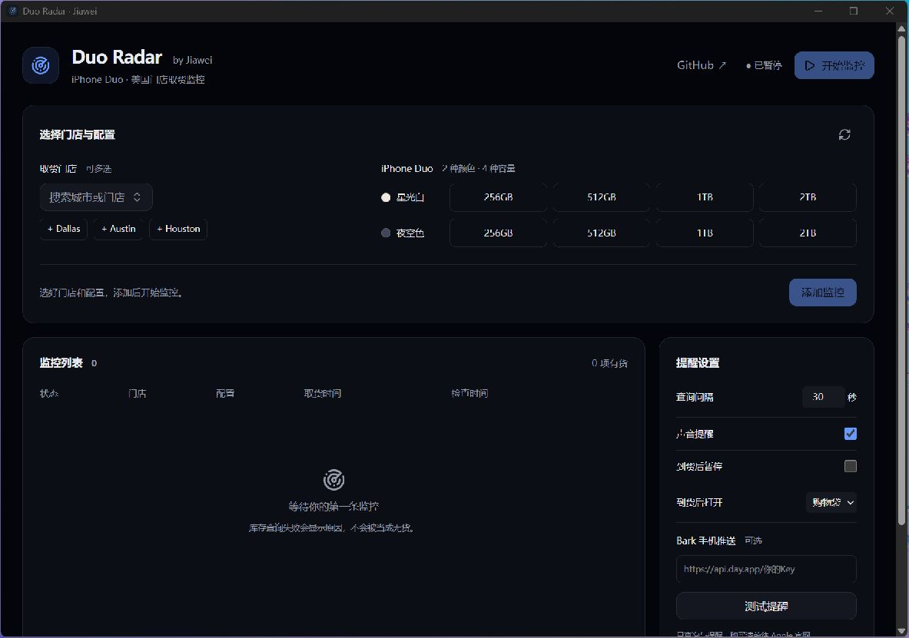

# Duo Radar

**Jiawei 的 iPhone Duo 美国门店取货监控。**

只关注你要买的 8 个配置：**星光白 / 夜空色 × 256GB / 512GB / 1TB / 2TB**。选好美国 Apple Store，交给电脑定时查询，有货后用声音或 Bark 提醒。

[下载 Windows 版](https://github.com/Jiawei11/duo-radar/releases/latest) · [反馈问题](https://github.com/Jiawei11/duo-radar/issues)



## 开始使用

1. 在 Releases 下载 `DuoRadar-1.1.0-setup.exe` 安装，或使用 `DuoRadar.exe` 直接运行。
2. 点击 Dallas、Austin、Houston 快捷按钮，或搜索其他美国门店。
3. 在两行配置按钮中选择颜色与容量，点击“添加监控”，再“开始监控”。
4. 按需开启声音、填写 Bark 手机推送地址，先测试提醒。

运行环境：Windows 10/11 x64，已安装 Chrome 或 Edge。电脑休眠、关机或彻底退出后不会查询；关闭窗口会收进托盘。

## 精简到需要的功能

- 仅美国、仅 iPhone Duo，8 个颜色容量组合，支持多选。
- 达拉斯、奥斯汀、休斯顿及周边 14 家店快捷选择，亦可搜索其他美国门店。
- 默认每轮结束后 30 秒再查；支持声音、Bark、打开 Apple 商品页或购物袋。
- 有货、无货、待开放取货、查询失败分开显示。403 / 541 / 429 和网络错误不会伪装成无货。
- 无中国大陆送货地址、无其他品类选择、无自动结账入口、无原作者社交推广。
- 设置与专属查询浏览器保存在 `%APPDATA%\duo-radar\`；不读取日常浏览器资料。

这是查询和提醒工具，不预留库存、不下单、不付款。最终取货资格和库存以 Apple 官网结账结果为准。Bark 地址含设备凭证，请勿贴进公开 Issue。

## 查询方式与验证

Rust 后台通过独立 Chrome/Edge 会话访问 Apple 美国站的公开取货接口，使用美国商品 SKU 和门店 ZIP 查询，并按门店编号精确匹配。数据解析、请求间隔、错误状态保留在后台处理。

Windows 本机已验证 Dallas NorthPark Center、Austin Domain NORTHSIDE、Houston Galleria 的浏览器查询。iPhone Duo 的 8 个配置在测试时返回“10.24 再查看取货情况”，界面显示“待开放取货”，不会触发有货提醒。该记录不代表当前库存。

## 从源码运行

依赖：Rust 1.90+ MSVC、Node.js 22.12+、pnpm、Visual Studio C++ Build Tools、Windows SDK。

```powershell
git clone https://github.com/Jiawei11/duo-radar.git
cd duo-radar
pnpm install
pnpm tauri dev
```

```powershell
pnpm test
pnpm build
cargo test --workspace --lib --tests
pnpm tauri build --bundles nsis
```

手动验证三城 × 8 个 Duo 配置，仅查询，不购买：

```powershell
cargo test -p apple-store-inventory-monitor live_duo_texas_eight_variants -- --ignored --nocapture
```

构建产物位于 `target/release/` 和 `target/release/bundle/nsis/`。VS Code 的“运行任务”也提供开发、构建和真实查询测试入口。

## S/O · Contributors

- **[Jiawei11](https://github.com/Jiawei11)**：本版本维护者；产品方向、Duo 专用需求、德州门店与发布。
- **[suversal / 果到雷达](https://github.com/suversal/apple-store-inventory-monitor)**：直接上游，提供 Chromium 查询、批量监控和提醒等基础。
- **[ENCHIGO](https://github.com/ENCHIGO/apple-pickup-watcher)**、**[hteen](https://github.com/hteen/apple-store-helper)** 及上游贡献者：原始监控项目与核心基础。
- **OpenAI Codex / ChatGPT**：协助美国站适配、Duo 专用界面、测试、文档和 Windows 打包。

本项目是基于果到雷达的修改版，保留上游 Git 历史、版权与来源声明；不声称上述基础代码由本版本重新原创。GitHub 侧栏 Contributors 由实际 Git 历史自动生成，AI 协作贡献在此明确致谢。

## 许可

继续使用 **GPL-3.0-or-later**。原许可全文见 [LICENSE](LICENSE)，完整来源与修改声明见 [NOTICE](NOTICE)。分发修改版本时请一并提供相应源码及许可。与 Apple Inc. 无隶属或授权关系。
