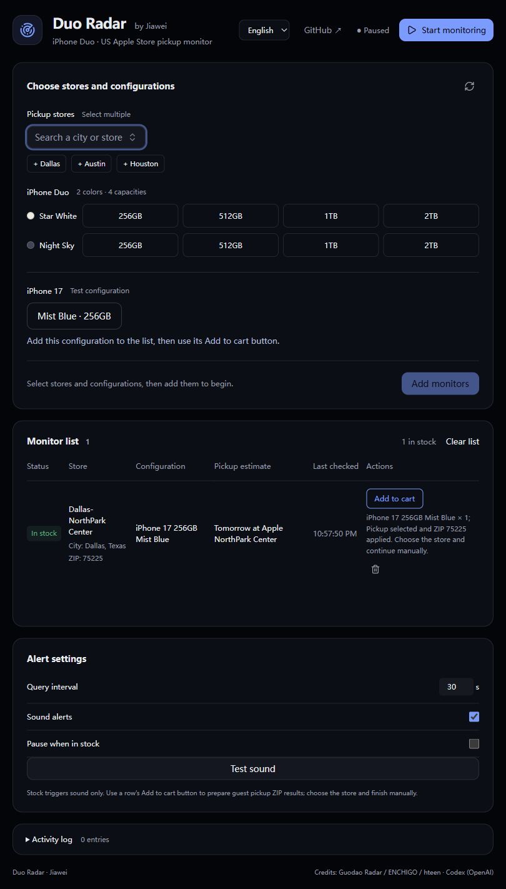
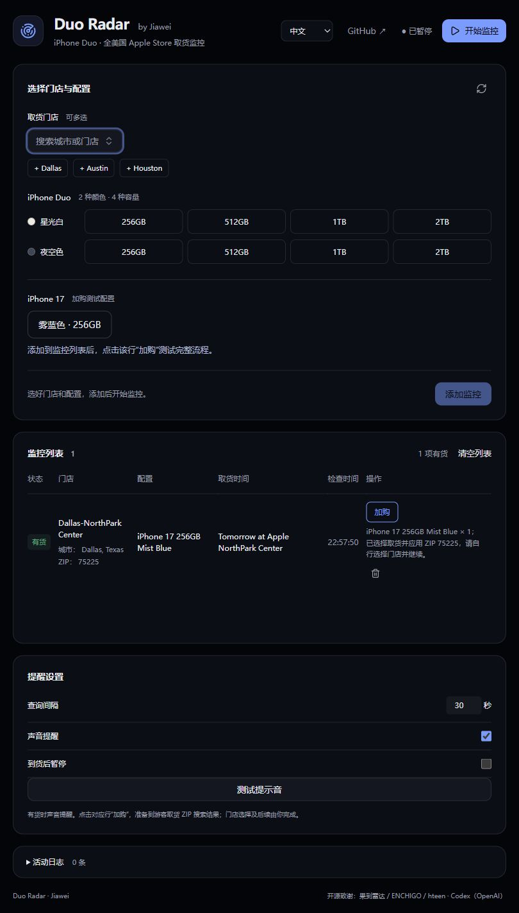

# Duo Radar

**US Apple Store pickup inventory monitoring for iPhone Duo — by Jiawei.**
**Jiawei 的 iPhone Duo 美国 Apple Store 取货库存监控。**

[Download Windows / 下载 Windows 版](https://github.com/Jiawei11/duo-radar/releases/latest) · [Report an issue / 反馈问题](https://github.com/Jiawei11/duo-radar/issues) · [English](#english) · [中文](#中文)

## English

Duo Radar is a minimal Windows app for monitoring US Apple Store pickup stock. Choose **Star White or Night Sky × 256GB, 512GB, 1TB or 2TB**. Get a sound alert when Apple confirms availability, then use that monitor row’s **Add to cart** button to prepare a guest pickup search with the correct store ZIP.

<details>
<summary>Interface previews / 界面预览 (sample data / 示例数据)</summary>





</details>

### Get started

1. Download `DuoRadar-1.4.5-setup.exe` to install, or run `DuoRadar.exe` directly. Requires Windows 10/11 x64 and Google Chrome or Microsoft Edge.
2. The app starts in **English**. Use the **English / 中文** selector at the top to switch languages. Your preference is saved on this computer; switching does not reset monitors or selections.
3. Search any US store, or use the Dallas, Austin and Houston shortcuts covering 14 Texas stores. Select configurations, click **Add monitors**, then **Start monitoring**.
4. When stock is found, click **Add to cart** on the matching row. Wait for its completion message, then choose the actual pickup store and finish manually on Apple.

The monitor list shows each store’s city, state and ZIP. **Clear list** pauses monitoring before removing all entries and asks for confirmation. Closing the window minimizes to the tray; use **Quit / 退出** to exit. Sleep, shutdown and a full exit stop inventory checks.

### What the app does

- US stores only; eight iPhone Duo configurations plus **iPhone 17 256GB Mist Blue** for testing.
- Sound alerts and an optional pause when stock is found; a default 30-second delay after each cycle.
- Separate states for in stock, out of stock, pickup not yet open and query failure. HTTP 403 / 541 / 429, missing SKUs and network failures are never presented as “out of stock.”
- A separate browser/cart for each **store + configuration**, isolated from your everyday Chrome/Edge profile.
- A row’s cart flow selects no trade-in, full payment, connect to a carrier later and no AppleCare; verifies the exact SKU and quantity **1**; then performs **Check Out → Continue as Guest → I’ll pick it up → store ZIP → Apply**.
- Automation stops after the ZIP editor closes and pickup store results load. **It does not choose a store, click Continue to Pickup Details, enter contact/payment information or place an order.** Reopening a prepared row brings its existing browser forward and preserves manual progress.
- Optional Bark phone alerts; no mainland-China delivery settings, other product categories or automatic browser opening on stock events.

Apple’s product names, store names, pickup quotes and unrecognized external diagnostics remain verbatim for accurate comparison. App controls, statuses and common diagnostics support English and Chinese. The selected UI language is stored locally in the WebView; settings and dedicated browser profiles are under `%APPDATA%\duo-radar\`.

This is a community tool, not an Apple product. It does not guarantee stock, reserve an item or pay for an order. Final stock and pickup eligibility are determined by Apple.

### Validation and limitations

The Windows browser engine has queried representative stores in Dallas, Austin, Houston, New York, San Francisco and Los Angeles. This verifies the cross-state query path, not every US store or future availability. Two independent iPhone 17 guest-cart sessions applied **75225 / NorthPark Center R144** and **10153 / Fifth Avenue R095** and returned the correct city’s results. Reopening the first session did not add another item.

Duo pickup was not yet open during those tests, so its real add-to-cart flow remains unverified until availability opens. Historical test results are not live stock. See [v1.2 validation](docs/v1.2-validation.md) and [v1.3 validation](docs/v1.3-validation.md).

### Build from source

Requirements: Rust 1.90+ MSVC, Node.js 22.12+, pnpm, Visual Studio C++ Build Tools and Windows SDK.

```powershell
git clone https://github.com/Jiawei11/duo-radar.git
cd duo-radar
pnpm install
pnpm tauri dev
```

```powershell
pnpm test
pnpm build
cargo test --workspace --lib --tests
pnpm tauri build --bundles nsis --config .github/unsigned-build.json
```

Build outputs: `target/release/` and `target/release/bundle/nsis/`. VS Code tasks provide development, build and live-test commands. Live tests are opt-in:

```powershell
# Inventory only; no purchase
cargo test -p apple-store-inventory-monitor live_us_nationwide -- --ignored --nocapture
cargo test -p apple-store-inventory-monitor live_duo_texas_eight_variants -- --ignored --nocapture
# Adds iPhone 17 and prepares guest pickup ZIP results; never places an order
cargo test -p apple-store-inventory-monitor live_us_cart_and_repeat -- --ignored --nocapture
```

### Credits and license

- **[Jiawei11](https://github.com/Jiawei11)** — maintainer, product direction, US/Duo requirements and releases.
- **[suversal / Guodao Radar](https://github.com/suversal/apple-store-inventory-monitor)** — direct upstream; Chromium queries, batch monitoring and notification foundations.
- **[ENCHIGO](https://github.com/ENCHIGO/apple-pickup-watcher)**, **[hteen](https://github.com/hteen/apple-store-helper)** and upstream contributors — original projects and core foundations.
- **OpenAI Codex / ChatGPT** — assisted with US adaptation, UI, English/Chinese localization, tests, documentation and Windows packaging.

This is a modified version of Guodao Radar, retaining upstream Git history, copyrights and provenance. GitHub’s Contributors sidebar is generated from Git history; AI assistance is acknowledged here. Licensed under **GPL-3.0-or-later**; see the unchanged [LICENSE](LICENSE) and [NOTICE](NOTICE). Corresponding source is provided with releases. Not affiliated with or endorsed by Apple Inc.

Historical upstream documents are in [docs/upstream](docs/upstream/README.md), with an English reading guide and the preserved original Chinese text. They describe older upstream features, not the current Duo Radar feature set.

## 中文

Duo Radar 是极简的 Windows 美国 Apple Store 取货监控工具，专注 **星光白 / 夜空色 × 256GB / 512GB / 1TB / 2TB** 八个配置。Apple 明确返回有货后播放声音，你可点击该行“加购”，准备到对应 ZIP 的游客取货搜索结果。

### 开始使用

1. 下载 `DuoRadar-1.4.5-setup.exe` 安装，或直接运行 `DuoRadar.exe`。需要 Windows 10/11 x64 和 Chrome 或 Edge。
2. 首次默认显示 English，顶部 **English / 中文** 可即时切换并记住选择；不会清空监控或已选配置。
3. 搜索全美国门店，或使用 Dallas、Austin、Houston 的 14 家德州门店快捷按钮。选择配置，点击“添加监控”，再“开始监控”。
4. 看到有货后点击对应行“加购”，等待完成提示，再自行选择实际取货门店和完成后续流程。

门店名下显示城市、州和 ZIP。“清空列表”需确认，并先暂停监控。关闭窗口会收进托盘，使用“Quit / 退出”完全退出；电脑休眠、关机或彻底退出后停止查询。

### 功能与边界

- 仅美国门店、Duo 八配置，另有 iPhone 17 雾蓝色 256GB 测试配置。
- 声音提醒、到货后可暂停；默认每轮结束 30 秒后再查。
- 有货、无货、待开放取货、查询失败分开显示；HTTP 403 / 541 / 429、缺失 SKU 和网络故障不冒充无货。
- 按“门店＋配置”隔离浏览器和购物袋，不读取日常 Chrome/Edge 用户资料。
- 每行加购会选择无折抵、全款、稍后连接运营商、不加 AppleCare，核对 SKU 与数量 1，再执行 Check Out → Continue as Guest → I’ll pick it up → 门店 ZIP → Apply。
- ZIP 编辑框收起、门店结果加载后停止；不选门店，不点 Continue to Pickup Details，不填联系人或付款信息，不提交订单。重复点击已准备条目只显示原浏览器，保留手动进度。
- 可选 Bark 手机推送；无中国大陆送货地址和其他品类选择，库存事件不自动打开浏览器。

控件、状态和常用诊断支持中英文。Apple 商品名、门店名、取货说明及无法识别的外部诊断保留原文，便于核对。界面语言保存在本机 WebView，设置及专用浏览器资料在 `%APPDATA%\duo-radar\`。

本工具不保证库存、不预留商品、不付款；最终库存及取货资格以 Apple 为准。与 Apple 无隶属或授权关系。

### 验证与开发

已验证 Dallas、Austin、Houston、New York、San Francisco、Los Angeles 的代表门店查询，不代表逐一验证所有门店。两个独立 iPhone 17 游客购物袋分别应用 75225（NorthPark Center R144）和 10153（Fifth Avenue R095），结果未串用；重开第一条不重复加购。Duo 在测试时尚未开放取货，真实加购仍待验证。历史记录不代表当前库存，详见上方验证文档。

源码运行、构建、产物位置与可选真实测试见上方英文部分的命令。真实游客测试会加购并进入 ZIP 搜索结果，但不提交订单。

### 致谢与许可

Jiawei11 维护本版；感谢直接上游 suversal / 果到雷达、ENCHIGO、hteen 及全部上游贡献者。OpenAI Codex / ChatGPT 协助美国适配、界面、双语、测试、文档和打包。保留全部上游 Git 历史、版权与来源，不声称基础代码为本版原创；AI 协作在此明确致谢。

继续使用 **GPL-3.0-or-later**，正式许可原文 [LICENSE](LICENSE) 不作改写，来源及修改见 [NOTICE](NOTICE)，发布时提供对应源码。上游历史文档保留原文并附英文导读，不应当作本版当前功能说明。


## Proxy settings / 代理设置

Open **Proxy** at the top right and select **Import proxies**. Paste one `IP:PORT:USER:PASSWORD` per line; confirm to append and deduplicate. The page displays each proxy and offers **Test** / **Test all** against `https://www.apple.com/shop` (three tests concurrently, 25-second request timeout). Successful HTTP responses show elapsed milliseconds; failures remain visible. These tests check connectivity, not inventory availability.

Enable **Proxy** in the monitor settings to route each inventory query batch through the next proxy. The cursor continues between cycles, including when there are fewer tasks than proxies. A query batch may contain multiple models for one store. Up to four store batches run concurrently. Up to 32 isolated proxy sessions remain resident and are reused across cycles; a set of 25 proxies no longer restarts on every rotation. Each completed store updates and notifies immediately. Retaining more sessions uses more memory. A failed request is reported without a direct-network fallback. Toggling off affects the next batch; an already running batch finishes on its previous route. Cart actions retain the original connection. Credentials are encrypted under the current Windows account in the app configuration directory and never included in source archives.

点击右上角 **Proxy → 导入 Proxy**，每行粘贴一条 `IP:PORT:USER:PASSWORD`。确认后追加并去重，可查看每条代理并进行单条或全部测试。测试访问 `https://www.apple.com/shop`，最多同时测试三条，请求超时 25 秒；HTTP 响应显示耗时，失败显示错误。这是连通性测试，不代表库存查询结果。

在主页面监控设置中打开 **Proxy**，每个库存查询批次依次使用下一条代理，轮询位置跨轮次保留，任务少于代理数量时也会逐轮使用全部代理。同一门店多个型号可能合并为一个批次。最多四个门店批次并发查询，最多保留 32 个隔离代理会话跨轮次复用；25 条代理不再每次轮询都重启浏览器。每家门店查完立即更新与提醒。保留更多会话会增加内存占用。失败时显示错误，不自动转直连。关闭开关对下一批生效，正在执行的批次仍使用原线路。加购继续使用原有连接。凭据在应用配置目录由 Windows 当前账户加密保存，不打包进源码。

## Phone notifications and updates / 手机推送与软件更新

In Alert settings, enter your full Bark URL and click **Save**. In-stock messages
include the model, store and ZIP. **Test push** sends a sample message; clearing
and saving the URL disables phone notifications. Sound alerts remain independent.

在提醒设置输入完整 Bark 地址并保存。有货消息包含型号、门店和 ZIP。
“测试推送”发送示例消息；清空地址并保存可关闭手机推送，声音提醒独立控制。

**Updates** checks GitHub at startup or on demand. Downloaded updates must pass
signature verification before you choose **Exit and install**. Portable EXE users
will move to the installed app. Existing 1.4.3 users must manually install 1.4.4 once.
See [update documentation](docs/updates.md) for details.

“检查更新”支持启动检查和手动检查，下载并校验签名后，由你选择“退出并安装”。
免安装版通过此流程转为安装版。现有 1.4.3 用户需要先手动安装一次 1.4.4。
详情见[更新说明](docs/updates.md)。
